# Hey, I'm Pratham! 👋

### Actuarial Math & Statistics @ University of Manitoba · Winnipeg, MB

> *I don't fear death. I discount it.* 🕯️

## 🗂 Projects

| Project | What it is | Try&nbsp;it |
|---|---|---|
| 🎲 [**The Odds of a Lifetime**](https://github.com/soodpratham10/odds-of-a-lifetime) | An actuarial engine played as a game: run an insurance company for 20 years. Multiple state, multiple decrement and joint-life models, reserves and solvency | [▶&nbsp;Live](https://soodpratham10.shinyapps.io/odds-of-a-lifetime/) |
| ⚓ [**Matching the Promise**](https://github.com/soodpratham10/matching-the-promise) | Asset-liability matching for a closed annuity block: cash-flow matching, Redington and full immunization, key rate durations and 20-year rate storms | [▶&nbsp;Live](https://soodpratham10.shinyapps.io/matching-the-promise/) |
| 🖋 [**Pricing the Inevitable**](https://github.com/soodpratham10/pricing-the-inevitable) | Risk-based pricing of 19 insurance and annuity products as a tested R package, with a SQL rate book, an Excel rate calculator, a Quarto memo and a Python cross-check | [▶&nbsp;Live](https://soodpratham10.shinyapps.io/pricing-the-inevitable/) |
| 🛡 [**Capital Adequacy Stress Testing**](https://github.com/soodpratham10/capital-adequacy-stress-testing) | *In progress:* capital adequacy for a fictional public auto insurer in SAS: MCT, worst-year simulation, stress testing and reinsurance | 🚧 |

## 💫 About me

🌱 **Currently learning**
Pension mathematics, profit testing, and how to survive ALTAM

🔭 **Currently building**
Capital adequacy stress testing in SAS

👯 **Looking to collaborate on**
Actuarial, insurance and data projects, especially anything with models you can actually play with

💬 **Ask me about**
Life contingencies, why your premium is what it is, or the odds you outlive your friends

⚡ **Fun facts**
- I can tell you the probability you'll die this year. I won't, but I can.
- To me, a long life is just a large annuity factor
- Winnipeg winters taught me survival models before any textbook did

## 💻 Toolkit

        

## 📊 GitHub stats

## 🌐 Find me

[LinkedIn](https://www.linkedin.com/in/soodpratham)
